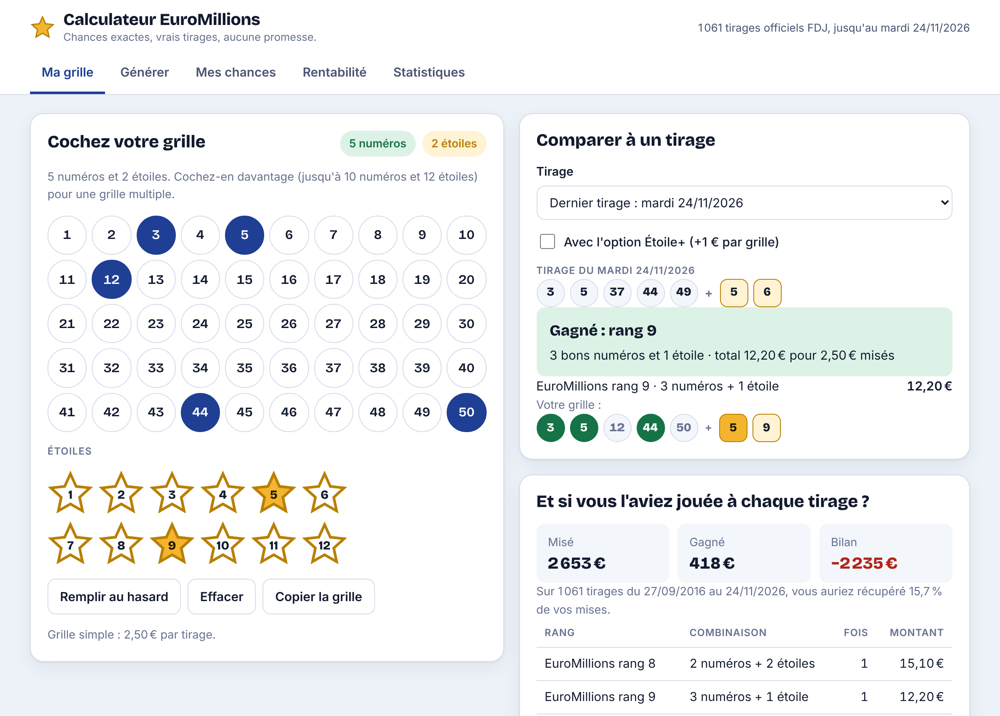

# Calculateur EuroMillions

[](https://github.com/dayti-0/Calculateur-Proba-Loto/actions/workflows/tests.yml)

Une page simple pour connaître vos vraies chances à l'EuroMillions – My Million, vérifier vos
grilles sur les tirages officiels et voir ce que le jeu rapporte réellement. Rien à installer,
pas de ligne de commande : elle s'ouvre d'un double-clic, hors connexion, sur ordinateur comme
sur téléphone.



> **Rappel honnête.** Chaque combinaison a exactement la même probabilité de sortir. Aucune
> méthode ne prédit un tirage ni n'augmente vos chances de gagner. Ce qui peut changer, c'est le
> nombre de personnes avec qui vous partageriez un gain : c'est le seul « avantage » que cet outil
> cherche à vous donner, et il est mesuré, pas promis.

## Ouvrir l'interface

1. Sur la page GitHub du projet, cliquez sur le bouton vert **Code**, puis sur **Download ZIP**.
2. Décompressez le fichier téléchargé.
3. Double-cliquez sur **`interface.html`** : la page s'ouvre dans votre navigateur.

Tout est dans ce fichier : les règles officielles de la FDJ et les 1 061 tirages réels du
27/09/2016 au 24/11/2026. Vos grilles et réglages sont mémorisés par le navigateur d'une visite à
l'autre.

## Ce que fait l'interface

| Onglet | Ce que vous pouvez faire |
|---|---|
| **Ma grille** | Cocher vos numéros et étoiles comme sur un bulletin, grilles multiples comprises. Voir ce qu'elle a gagné à n'importe quel tirage officiel, avec les vrais montants, Étoile+ comprise. Savoir ce qu'elle aurait rapporté si vous l'aviez jouée à chaque tirage depuis 2016, et si elle est très jouée par les autres joueurs. |
| **Générer** | Obtenir de 1 à 20 grilles : moins partagées (recommandé), au hasard, équilibrées, ou couvrant un maximum de numéros, avec vos numéros fétiches si vous le souhaitez. |
| **Mes chances** | La probabilité exacte de chaque rang et de l'Étoile+, le gain moyen de chaque rang, et un calculateur de grille multiple (prix, chances, gains selon le tirage). |
| **Rentabilité** | Ce que rapporte en moyenne une grille à 2,50 € selon le jackpot annoncé, et une simulation de 1 000 joueurs pendant plusieurs années. |
| **Statistiques** | Les sorties de chaque numéro et étoile, un test d'équité des tirages, les numéros les plus et les moins joués, les derniers tirages. |

## Ce qu'il faut retenir

| Question | Réponse (règles en vigueur) |
|---|---|
| Gagner le jackpot (5 + 2) | 1 chance sur 139 838 160 |
| Gagner quelque chose | 1 chance sur 12,97 (1 sur 4,73 à l'Étoile+ seule) |
| Attente moyenne du jackpot avec 1 grille à chaque tirage | 1 340 024 ans |
| Part moyenne récupérée pour 2,50 € | de 33 % (jackpot de 17 M€) à 84 % (250 M€) |
| Jackpot qui rendrait le jeu rentable | environ 320 M€, au-dessus du plafond légal de 250 M€ : jamais en tirage ordinaire |
| Les tirages sont-ils équitables ? | Oui : test du khi² sur 1 061 tirages, p = 0,29 (numéros) et 0,18 (étoiles) |
| Numéros les plus joués par les Européens | 7 (+25 %), 13, 17, 23, 11, 12, 19, 9 : les numéros ≤ 31 (dates) en général |
| Numéros les moins joués | 46 (−18 %), 36, 41, 48, 47, 43, 40, 49 ; étoile 12 (−25 %) |
| Joueur typique sur 20 ans (simulation) | récupère 16 % de ses mises ; aucun joueur sur 1 000 ne finit gagnant |

## Mettre à jour les tirages

La page livrée contient les tirages jusqu'au 24/11/2026. Avec Python 3.10 ou plus installé,
depuis le dossier du projet, une commande télécharge l'historique officiel à jour sur fdj.fr :

```bash
python3 -m proba_loto maj
```

Une autre ouvre ensuite l'interface avec ces nouveaux tirages :

```bash
python3 -m proba_loto
```

## Méthodes et sources

**Règles.** Elles proviennent du règlement EuroMillions – My Million et Étoile+ homologué par
l'ANJ le 27 mars 2025 (décision 2025-PR-054) et sont décrites comme des données dans
[`proba_loto/jeux.py`](proba_loto/jeux.py). Mise de 2,50 € (2,20 € EuroMillions + 0,30 € My
Million), 50 % des mises EuroMillions aux gagnants (1,10 € par grille), part de chaque rang,
jackpot minimum de 17 M€, plafond de 250 M€, Étoile+ à 1 € (60 % redistribués), tableau des
grilles multiples (5 à 10 numéros, 2 à 12 étoiles, au plus 396 grilles simples).

**Probabilités.** Calcul exact : le nombre de grilles ayant `a` bons numéros et `b` bonnes étoiles
vaut C(5, a)·C(45, 5−a)·C(2, b)·C(10, 2−b). Toutes les valeurs sont comparées aux tableaux du
règlement dans les tests.

**Espérance.** Les rangs 2 à 13 rapportent en moyenne 1,10 € × 40 % = 0,44 € par grille. Le
jackpot est partagé entre les gagnants : avec S grilles jouées, la part moyenne d'un gagnant vaut
(1 − e^−λ)/λ où λ = S / 139 838 160. My Million : 1 M€ divisé par le nombre de codes français. Le
nombre de grilles jouées est estimé d'après le jackpot par une régression sur les tirages
2020-2026 (17 M€ → 16 millions de grilles, 250 M€ → 41 millions), la part française à 21,6 %.

**Popularité.** Un gain partagé entre beaucoup de gagnants révèle des numéros très joués : le
rapport du rang 13 (environ 700 000 gagnants par tirage) mesure la popularité des numéros tirés,
indépendamment des ventes. Une régression sur les 1 061 tirages estime l'effet de chaque numéro et
de chaque étoile. Estimé sur les 75 % de tirages les plus anciens, le modèle prédit les 25 % plus
récents avec une corrélation de 0,97.

**Statistiques.** Le test du khi² est corrigé pour le tirage sans remise (les 5 numéros d'un
tirage sont distincts).

**Données.** [`proba_loto/data/euromillions.csv`](proba_loto/data/euromillions.csv) est généré à
partir des archives officielles de la FDJ ; voir [`SOURCE.md`](proba_loto/data/SOURCE.md).

## Règles en vigueur et évolutions annoncées

Les calculs suivent les règles en vigueur au 27 novembre 2026. Une réforme de l'EuroMillions est
annoncée pour le **tirage du 2 mars 2027** : plafond du jackpot porté de 250 M€ à 260 M€, puis par
paliers jusqu'à 300 M€, grille annoncée à 3 € et jeux additionnels refondus (l'Étoile+ pourrait
être remplacée). Le détail officiel n'étant pas encore publié, il n'est pas intégré : il suffira
alors de mettre à jour `jeux.py` et de régénérer la page.

## Pour les curieux : ligne de commande et Python

Tout ce que fait l'interface existe aussi en commandes (`python3 -m proba_loto <commande>`) :
`probas`, `generer`, `verifier`, `multiple`, `esperance`, `simuler`, `stats`, `popularite`,
`retro`, `analyser`, `maj`, `interface` et `menu` (menu dans le terminal). L'aide détaillée
s'affiche avec `python3 -m proba_loto --help`.

La bibliothèque s'utilise aussi directement en Python :

```python
>>> from proba_loto import EUROMILLIONS, Grille, verifier, analyser_multiple, calculer_esperance
>>> from proba_loto import affichage as fmt
>>> from proba_loto.probabilites import probabilite_gain
>>> fmt.chances(probabilite_gain(EUROMILLIONS), decimales=2)
'1 sur 12,97'
>>> grille = Grille.depuis_texte(EUROMILLIONS, "3 5 12 44 50 + 5 9")
>>> tirage = Grille.depuis_texte(EUROMILLIONS, "3 5 37 44 49 + 5 6")
>>> verifier(grille, tirage).gains  # rang → nombre de grilles gagnantes
{9: 1}
>>> analyser_multiple(EUROMILLIONS, 7, 3).nb_simples
63
>>> e = calculer_esperance(59e6, ventes=25e6, codes_my_million=5e6)
>>> fmt.euros(e.total), fmt.pourcentage(e.taux_retour)
('1,03 €', '41,1 %')

```

## Développement

```bash
python3 -m pip install -e ".[dev]"
```

```bash
python3 -m pytest
```

Les tests vérifient chaque probabilité contre le règlement, les multiples contre le tableau
officiel, la répartition théorique contre les rapports réels, l'historique, la ligne de commande,
et que les calculs JavaScript de l'interface donnent exactement les mêmes résultats que la
bibliothèque Python (quand Node et Playwright sont disponibles). Ils tournent sous Python 3.10 à
3.14 via GitHub Actions. L'[audit](AUDIT.md) détaille les corrections apportées depuis la première
version.

`interface.html` est générée à partir de [`proba_loto/web/interface.html`](proba_loto/web/interface.html)
et des données. Après une modification, régénérez-la (un test vérifie qu'elle est à jour) :

```bash
python3 -m proba_loto --donnees proba_loto/data/euromillions.csv interface --sortie interface.html --sans-ouvrir
```

```text
interface.html        l'interface (page autonome, générée)
proba_loto/
├── web/interface.html  modèle de l'interface
├── jeux.py           règles officielles (EuroMillions, Étoile+)
├── probabilites.py   probabilités exactes
├── grilles.py        saisie, validation, vérification
├── multiples.py      grilles multiples
├── generateur.py     stratégies de génération
├── analyse.py        profil et motifs d'une grille
├── esperance.py      espérance de gain
├── simulation.py     simulation sur plusieurs années
├── historique.py     historique officiel FDJ (lecture, mise à jour)
├── statistiques.py   fréquences, khi², rétro-test
├── popularite.py     popularité des numéros
├── interface.py      génération de la page
├── cli.py            ligne de commande et menu
└── data/             historique officiel livré
```

## Jouer de façon responsable

Les jeux d'argent sont interdits aux mineurs. Jouer comporte des risques : endettement,
isolement, dépendance. Pour être aidé : **Joueurs Info Service, 09 74 75 13 13** (appel non
surtaxé), [joueurs-info-service.fr](https://www.joueurs-info-service.fr).

Projet indépendant, sans lien avec la Française des Jeux. Les montants officiels font foi sur
[fdj.fr](https://www.fdj.fr).

## Licence

[MIT](LICENSE).
